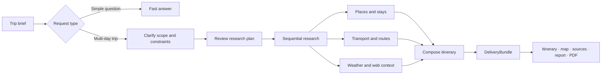

<div align="center">

<h1>JourneyPilot</h1>

<p>
  <picture>
    <source media="(prefers-color-scheme: dark)" srcset="docs/assets/logo-lockup-night.png">
    <source media="(prefers-color-scheme: light)" srcset="docs/assets/logo-lockup-day.png">
    
  </picture>
</p>

<strong>Evidence-backed travel planning, from a rough idea to a trip you can use.</strong>

<p>
JourneyPilot researches transport, places, weather, routes, and the open web, then brings everything
together in a day-by-day itinerary, map, report, and printable PDF.
</p>

[](LICENSE)
[](https://python.org)
[](https://nodejs.org/)

**English** | [简体中文](README.zh-CN.md)

</div>

JourneyPilot is an open-source, self-hosted AI travel planning workspace. Give it dates, destinations,
preferences, and constraints, and it turns provider data into a trip you can review and refine instead
of a one-off answer hidden in a chat. Research results, weather, map, report, and PDF stay connected:
sources remain attached to the facts they support.

The product interface is in Simplified Chinese. Code identifiers, configuration keys, API contracts,
and command output are in English; documentation is primarily Chinese.

## Quick start

### Prerequisites

- [uv](https://docs.astral.sh/uv/)
- Docker Desktop or Docker Engine with Compose
- Python 3.11
- Node.js 22 (minimum 20.19) and npm

### Run JourneyPilot

```bash
git clone https://github.com/Lagom-TA/JourneyPilot.git
cd JourneyPilot
cp backend/config.example.yaml config.yaml
```

Fill the model section from a provider preset, then supply the API key through the environment.
Keys never belong in `config.yaml` — that file gets copied and pasted into issues:

```bash
export UV_PROJECT_ENVIRONMENT="$PWD/.venv"
uv run --project backend python backend/journeypilot.py configure --list              # available presets
uv run --project backend python backend/journeypilot.py configure --provider deepseek # writes the model section
export JOURNEYPILOT_PRIMARY_MODEL__API_KEY="your-api-key"
export JOURNEYPILOT_FAST_MODEL__API_KEY="your-api-key"
```

Start the app with the PostgreSQL and Redis ports used by the included Compose stack:

```bash
JOURNEYPILOT_DATABASE__PORT=55433 JOURNEYPILOT_REDIS__PORT=16379 ./run.sh
```

The first start installs backend and frontend dependencies, starts PostgreSQL and Redis via Compose, runs
database migrations, and launches the API and the web app. The default local embedding model is
downloaded on first use.

| Service | URL |
|---|---|
| Web app | <http://localhost:8080> |
| API documentation | <http://localhost:8001/docs> |
| Readiness check | <http://localhost:8001/api/health/ready> |

Useful commands:

```bash
./run.sh status
./run.sh logs backend      # or: ./run.sh logs frontend
./run.sh check
./run.sh stop
```

`./run.sh restart` is `stop` followed by `start`: it does **not** keep environment variables. Either pass
the overrides again, or save `database.port: 55433` and `redis.port: 16379` in `config.yaml`.

> `backend/config.example.yaml` targets a local PostgreSQL on 5433 and Redis on 6379; the bundled Compose
> stack uses 55433 and 16379. Keep the two in sync via the environment variables above or by editing
> `config.yaml`.

### Optional capabilities

The default install carries the core product: chat, planning, PostgreSQL/pgvector, Redis, MCP tools,
PDF export, and document import. Heavier enhancements are opt-in; a configuration that asks for one
without its dependency **refuses to start** instead of failing on the first real call:

```bash
uv sync --project backend                            # core: remote embeddings only (embedding.provider=openai)
uv sync --project backend --group local-embedding    # local Qwen3 ONNX embeddings (the shipped default; what run.sh installs)
uv sync --project backend --group cross-encoder      # BGE reranker (rerank.provider=cross_encoder, pulls torch)
```

The default Compose database is the official `pgvector` image and compiles nothing. Chinese word
segmentation (zhparser) is a **different image**, not a Compose profile:

```bash
docker build -t journeypilot-postgres:pg18-zhparser ./infra/postgres
POSTGRES_IMAGE=journeypilot-postgres:pg18-zhparser docker compose -f infra/compose.yml up -d
```

`journeypilot doctor` reports whether the zhparser extension is installed. It does **not** report which
text-search configuration an existing database actually uses: the generated `knowledge_chunks.tsv`
expression is fixed when the table is created. Enabling Chinese segmentation on an existing database
requires rebuilding the database (or a dedicated rebuild migration); switching the image alone is not
enough.

### Self-host with Docker Compose

The Compose stack builds the frontend inside the API image and serves it from the API process:

```bash
cp backend/config.example.yaml config.yaml   # fill in the model section; Compose mounts this file read-only
docker compose -f infra/compose.yml up -d --build
```

The web app and API are both at <http://localhost:8001>; PostgreSQL and Redis stay on the internal
network, with host ports 55433/16379 for local tooling. Put provider keys in `.env` (read by Compose,
never committed) or the shell environment. The Compose image installs the `local-embedding` dependency
group by default; set `DEPENDENCY_GROUPS` to change that.

## How it works

JourneyPilot chooses an execution path based on the request. Simple travel questions use a fast-answer
workflow. For multi-day trips, it reviews the brief, asks for necessary details and reassesses the
answers, then presents a research plan for approval. Only after approval does it run provider research,
compose the itinerary, and assemble the final delivery.



Research workers run in sequence per plan and return typed packets instead of free-form itinerary text.
The dispatcher collects the packets into a candidate catalog, and the model composes the itinerary
directly from that catalog. Structural parsing keeps the data readable and preserves source records next
to the facts they support; content quality is the model's responsibility. Once the result is ready it is
committed as a single `DeliveryBundle` and projected to every user-facing surface.

Under the hood, JourneyPilot combines a LangGraph workflow with FastAPI, PostgreSQL, Redis, Model Context
Protocol tools, hybrid retrieval, and a React workspace. Checkpoints and durable run records keep longer
planning sessions recoverable.

## Configuration

Settings are read from built-in defaults and `config.yaml`, with environment variables taking precedence.
Unknown fields are **rejected** rather than ignored, so a misspelled key fails loudly instead of silently
doing nothing.

- [`backend/config.example.yaml`](backend/config.example.yaml) — annotated starting point
- [`docs/configuration.md`](docs/configuration.md) — every field, default, range, and environment-variable
  name (generated by `journeypilot config docs`)
- [`docs/config.schema.json`](docs/config.schema.json) — JSON Schema for `config.yaml` (generated; usable
  for editor validation)

```bash
export UV_PROJECT_ENVIRONMENT="$PWD/.venv"
uv run --project backend python backend/journeypilot.py config show      # effective values + where each came from
uv run --project backend python backend/journeypilot.py config validate  # check without starting the service
uv run --project backend python backend/journeypilot.py config env       # every valid environment variable
```

Every field can be overridden with `JOURNEYPILOT_<section>__<field>`, for example
`JOURNEYPILOT_DATABASE__PORT=55433`. An unrecognised `JOURNEYPILOT_*` variable stops startup — a typo
should not be a silent no-op.

| Setting | What it controls |
|---|---|
| `primary_model.*` | Main OpenAI-compatible model used for planning and research. |
| `fast_model.*` | Optional lower-latency model. Empty connection values fall back to the primary model. |
| `embedding.*` | Local Qwen3 ONNX embeddings by default; `openai` for a compatible embedding service; `hash` for an offline smoke path. |
| `run_control.plan_gate_enabled` | Must stay enabled for deep research: pauses a run for plan review before research begins. When disabled, new deep-research requests are rejected before a run is created; fast answers still work. |
| `rerank.*` | Second-stage ranking for knowledge-base retrieval. |
| `run_deadline.*` | The four time windows one deep research run may spend. |
| `run_budget.*` | Call, token and cost ceilings sealed when a run is authorised. |
| `provider_channels.*` | Per-upstream concurrency, so an ingest cannot starve online requests. |
| `ingest.*` | Upload and document-parsing limits (size, pages, zip expansion, timeout). |
| `mcp.servers.*` | Credentials and settings for external research providers. |

### Data sources

JourneyPilot is useful with the providers that require no credentials, and gains more data sources as
more services are configured.

| Area | Included providers | Optional providers |
|---|---|---|
| Web research | DuckDuckGo, Fetch | Tavily, Brave, Firecrawl |
| Places and routing | OpenStreetMap, Nominatim, Transitous | Baidu Maps, Amap |
| Transport | China Railway (12306) | Duffel Flights |
| Weather and currency | Open-Meteo, Frankfurter | — |

Add provider credentials under `mcp.servers` in `config.yaml`, then check their status with:

```bash
uv run --project backend python backend/scripts/check_mcp.py
```

`config.yaml`, `.env*`, and other local credential files are ignored by Git.

The repository ships a small factory corpus under `backend/data/corpus/factory/`. With the backend
running, load it from another terminal with `python backend/scripts/load_factory_corpus.py`. The optional
local binary seed is not included in this public repository; if you maintain one, keep it under
`data/corpus/seed/`. Without a local seed, provider-backed research still works and the knowledge corpus
is reported as a non-blocking degraded component.

## Database, backups, and upgrades

The API process issues no DDL: it creates no tables, alters no columns, and deletes no rows on startup.
It only verifies, read-only, that the database matches the schema contract of the code that is running.
Schema changes are versioned migrations under [`backend/migrations/versions/`](backend/migrations/versions/),
applied by the `journeypilot` command:

```bash
export UV_PROJECT_ENVIRONMENT="$PWD/.venv"
uv run --project backend python backend/journeypilot.py doctor          # database, migration revision, schema, extensions, backups
uv run --project backend python backend/journeypilot.py migrate         # run pending migrations (holds a lock; backs up first)
uv run --project backend python backend/journeypilot.py backup          # verified backup: dump + manifest + SHA-256 checksums
uv run --project backend python backend/journeypilot.py restore <dir> --yes  # restore into a new database, verify, then switch
```

Every command accepts `--json` for CI use.

`migrate` runs **before** the API, not alongside it. Both supported entry points do this for you — the
Docker image entrypoint and `./run.sh start` each run it and refuse to start the API if it does not pass.
Running the API against a database that has not been migrated is not a degraded mode:
`GET /api/health/ready` returns 503 with the exact problem and the command that fixes it.

Because the API never needs DDL rights, you can run it under a PostgreSQL role that only has
`SELECT/INSERT/UPDATE/DELETE` and sequence usage, and reserve schema ownership for `journeypilot migrate`.
This is verified by a test, not just asserted.

What the safeguards actually do:

- **A non-empty database is backed up before any migration**, and the backup is verified (non-empty file,
  `pg_restore --list` parses, checksums recorded). If the backup fails, the migration does not run.
- **A non-empty database without a known revision is refused.** A database that has JourneyPilot tables
  but no `alembic_version` is not adopted or stamped: rebuild it, or restore a matching backup. `doctor`
  prints the exact columns, constraints, and indexes that differ for a schema drift.
- **Migrations that delete data require `--allow-destructive`.** A first install on an empty database
  does not, because there is nothing to lose.
- **Restore never overwrites the current database in place.** It restores into a new database, checks the
  schema fingerprint and row counts against the manifest, and only then switches. The previous database is
  kept as `<name>_prerestore_<timestamp>` until you delete it.
- **The LangGraph checkpoint tables are created by `migrate` too**, not by the API. They are owned by
  `langgraph-checkpoint-postgres` and carry their own version table; without them the API reports
  `checkpointer` as unavailable instead of failing on the first interrupt.

`maintenance.*` in `config.yaml` controls the backup directory, retention, and the lock timeout. Backups
are written outside version control.

## Development

Run the frontend against the local API:

```bash
cd frontend
npm ci
npm run dev
```

Before opening a pull request, run the local checks and validate the behavior your changes affect:

```bash
export UV_PROJECT_ENVIRONMENT="$PWD/.venv"

# Backend
uv sync --project backend --locked --group local-embedding --group dev
uv run --project backend ruff check --config backend/pyproject.toml backend/travel_agent/ backend/tests/ backend/scripts/
uv run --project backend python backend/journeypilot.py config validate
uv run --project backend python backend/journeypilot.py config docs --check    # generated field table matches the schema
JOURNEYPILOT_DATABASE__PORT=55433 uv run --project backend pytest -c backend/pyproject.toml      # db tests use temporary databases; skipped without PostgreSQL

# Frontend
cd frontend
npm run check                                        # type-check + lint + unit tests + build
npm run test:e2e                                     # needs a running stack; see frontend/e2e/README.md
```

[CI](.github/workflows/pr.yml) runs backend lint, configuration and unit checks, offline migration SQL,
frontend type-checks/lint/unit tests/build, MCP dependency installation, shell checks, a Docker build
smoke, and secret scanning. Database integration and migration tests are available through **Run
workflow** in the `PR` workflow. Full-stack browser and real-provider checks run locally as needed;
skipped database tests are not a passing result. There is no scheduled nightly or release workflow.

### Documentation

- [`docs/README.md`](docs/README.md) — documentation index
- [`docs/adr/`](docs/adr/) — the decisions, and what was rejected instead
- [`docs/invariants.md`](docs/invariants.md) — the runtime guarantees the code must preserve
- [`docs/architecture/overview.md`](docs/architecture/overview.md) — how one request travels through the system
- [`docs/local-development-troubleshooting.md`](docs/local-development-troubleshooting.md) — local setup troubleshooting

Issues and pull requests are welcome; see [CONTRIBUTING.md](CONTRIBUTING.md). Security reports follow
[SECURITY.md](SECURITY.md). Keep changes focused, add a regression test for bug fixes, and update both
README languages when behavior visible to users changes.

## Tech stack

| Layer | Technology |
|---|---|
| Frontend | React 18, TypeScript, Vite, Tailwind CSS, Leaflet, Motion |
| API | FastAPI, Uvicorn, Server-Sent Events |
| Agent workflow | LangGraph with PostgreSQL checkpoints |
| Models | OpenAI-compatible model routing through `langchain-openai` |
| Data | PostgreSQL, pgvector, Redis (zhparser optional) |
| Retrieval | Vector search, PostgreSQL full-text search, RRF, reranking |
| Tools | Model Context Protocol over stdio |
| Packaging | uv, npm, Docker Compose |

## License

JourneyPilot is available under the [MIT License](LICENSE). Third-party data, fonts, and assets are
listed in [NOTICE](NOTICE).

## Acknowledgments

JourneyPilot builds on [LangGraph](https://github.com/langchain-ai/langgraph), the
[Model Context Protocol](https://modelcontextprotocol.io/), [pgvector](https://github.com/pgvector/pgvector),
and open data from [Open-Meteo](https://open-meteo.com/), [Frankfurter](https://frankfurter.dev/),
[OpenStreetMap](https://www.openstreetmap.org/), Nominatim, and [Transitous](https://transitous.org/).
