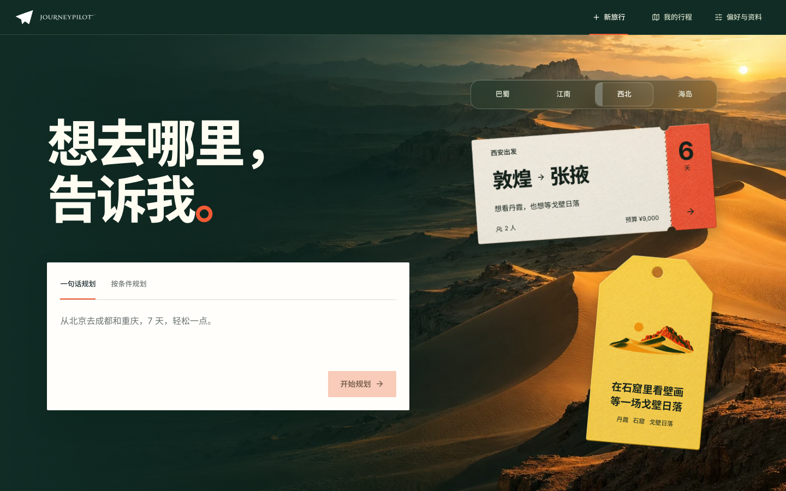
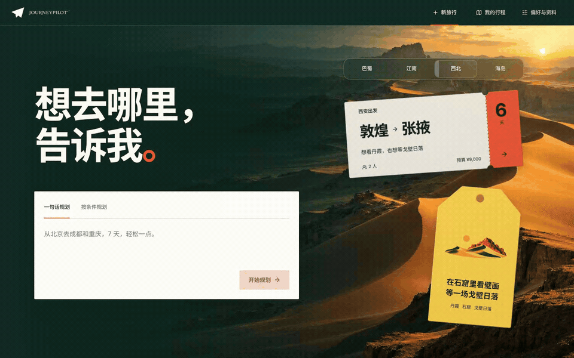
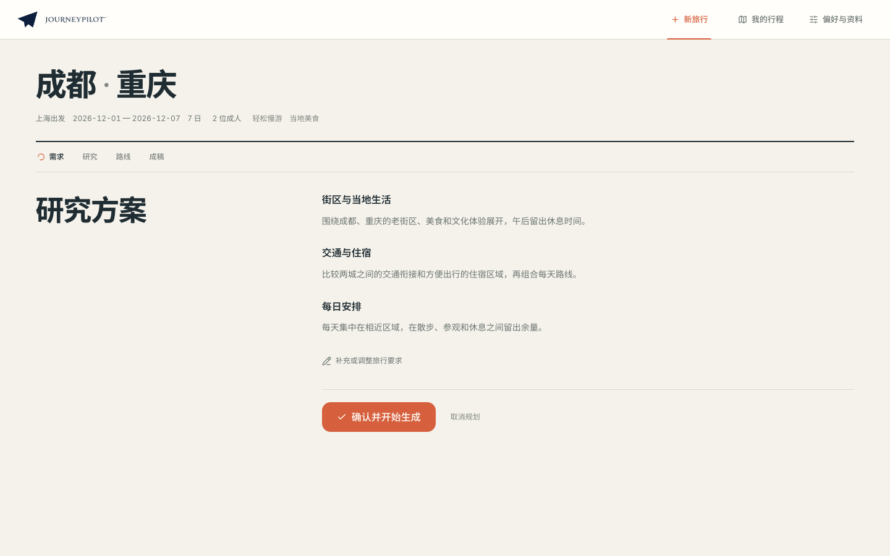
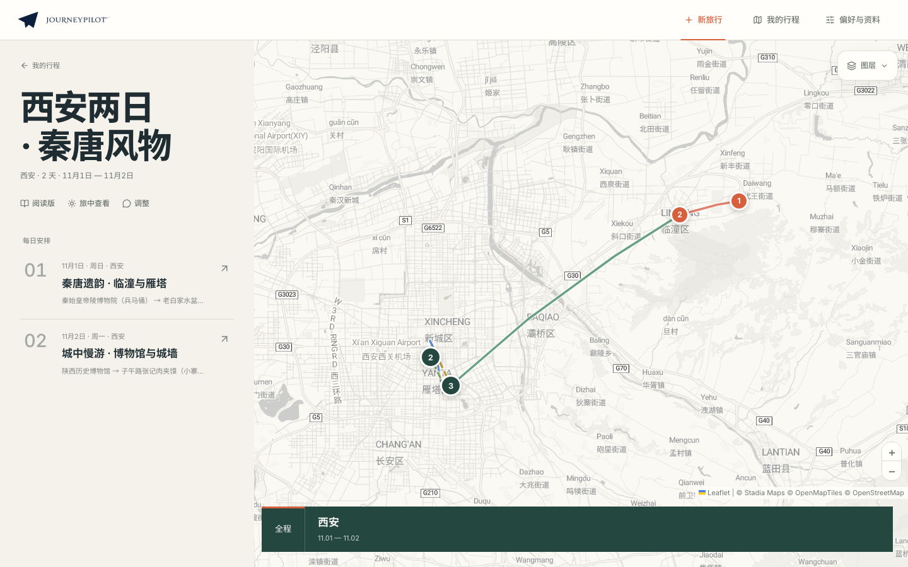
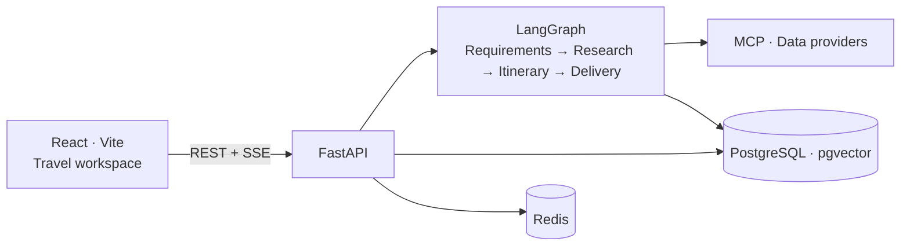

<div align="center">

<picture>
  <source media="(prefers-color-scheme: dark)" srcset="docs/assets/logo-lockup-night.png">
  <source media="(prefers-color-scheme: light)" srcset="docs/assets/logo-lockup-day.png">
  
</picture>

<h1>JourneyPilot</h1>

<p>A travel plan you can explore, discuss, and refine.</p>

[](LICENSE)
[](https://www.python.org/)
[](https://nodejs.org/)

**English** · [简体中文](README.zh-CN.md)

</div>

JourneyPilot is an open-source, self-hosted AI travel planning workspace (with a Simplified Chinese interface). Tell it where you want to go, when you are traveling, and who is coming along—it researches destinations, builds a day-by-day itinerary, and brings your schedule, interactive map, and reading view together in one place.

[Quick start](#quick-start) · [How it works](#architecture) · [Documentation](docs/README.md)





| Review the research plan | Explore the itinerary on a map |
| --- | --- |
|  |  |

[See the reading view](docs/assets/reading.png) · Map tiles: © [Stadia Maps](https://stadiamaps.com/attribution/) © [OpenMapTiles](https://openmaptiles.org/) © [OpenStreetMap contributors](https://www.openstreetmap.org/copyright)

## Plan a trip

**From idea to research plan**
Start by describing your trip in a single sentence, or switch to the structured form to fill in your route, dates, companions, budget, and travel style. The home page also automatically rotates curated inspiration proposals, which you can select manually to jump-start a draft; rotation pauses while you interact with the inspiration area or edit your trip. Switching between planning modes smoothly adjusts the layout while keeping each draft. The structured form stays compact in common desktop windows and remains scrollable when additional content is displayed. Before running deep searches, JourneyPilot organizes your requirements, verifies destinations, asks brief clarifying questions when key preferences are open, and presents a concise list summarizing the research plan for you to confirm or supplement. The complete requirements remain the basis for research and itinerary planning.

Starting planning from the home page opens the planning workspace with a brief transition while JourneyPilot immediately begins interpreting the request. The transition respects the system's reduced-motion setting. Once a planning task is created, follow-up questions and the research plan appear in the same workspace; ordinary questions and recommendation requests display their respective answers after routing is determined. Switching pages or starting another trip does not stop planning: find its status under My Trips and return to the same workspace. Planning depends on the current browser page's connection, so refreshing, closing the page, or losing network access may interrupt it; check the trip record for available recovery actions.

In the structured form, typing a location immediately shows matching local candidates, including common cities and search results cached on the current page. An online search automatically looks for more candidates without requiring a manual search, though it may be affected by network conditions. Autocomplete sends the entered location to the [Photon public demo server](https://github.com/komoot/photon#demo-server). It permits reasonable project use but may rate-limit heavy traffic or stop, has no SLA, and has limited Chinese-language coverage for some overseas locations. For production, deploy a reliable autocomplete service and adapt the places endpoint. The page-level search-result cache is cleared on refresh, and no additional API key is needed. On the home page, you can submit an unconfirmed destination for verification during planning.

**Multi-source research and scheduling**
Once the research plan is confirmed, JourneyPilot gathers information in parallel across attractions, neighborhoods to stay, transport options (including China Railway 12306, flights, and local routing), and weather forecasts. A consistent task list shows each research task's latest progress and status. Expand a task to inspect model notes, tool queries, and sources; longer activity lists scroll within the task. Adjacent calls to the same tool may be grouped, with each call's details still available. Train services found during research or follow-up searches become itinerary options, so transport and activities can be scheduled around geography and opening hours. Within the existing deadline, composition reserves time for a final draft and materialization and bounds follow-up research; unverified transfers are marked for review rather than presented as complete facts. If a route exceeds its available time window and cannot be rescheduled in time, the remaining days are preserved and the affected day is left unplanned, with an ISO-dated “尚未安排” notice in the workspace, reading view, and PDF. This partial delivery does not guarantee that every other arrangement is feasible.

**Map, itinerary, and reading view in sync**
The delivery workspace pairs a full-route interactive map and city stay segments with your daily schedule. Select a place card to locate it on the map; cards bring together useful details such as times, addresses, opening hours, and available flight numbers. Sources appear when there is useful material to view. Open the reading view for the full guide or export it as a PDF travel handbook.

**Iterative refinement and personal memory**
Planning doesn't end with the first draft. You can continue chatting in the same workspace to adjust daily pacing, swap stops, or adapt to weather changes over multiple turns. The adjustment composer stays at the bottom while messages scroll, and you return to the itinerary from the same navigation position where you opened the conversation. Saved trips, reusable travel styles, personal preferences, and reference materials live in your local archive so future plans can build on what you like. For a new trip, your submitted description, form values, and follow-up answers form the basis for planning; relevant memories provide context, while the current trip's information takes precedence.

## Architecture



The backend orchestrates LLM and tool calls, persists trip state and deliverables in PostgreSQL and Redis, and streams live progress to the browser over SSE. See the [architecture overview](docs/architecture/overview.md) for module boundaries and data flow.

## Quick start

Prerequisites: [uv](https://docs.astral.sh/uv/), Python 3.11, Node.js (Node 22 recommended, see `frontend/.nvmrc`), Docker with Compose, and API credentials for an LLM provider.

**1. Clone the repository and create a config file**

```bash
git clone https://github.com/Lagom-TA/JourneyPilot.git
cd JourneyPilot
cp backend/config.example.yaml config.yaml
export UV_PROJECT_ENVIRONMENT="$PWD/.venv"
```

**2. Choose a model preset and set your API key**

The example below uses DeepSeek (`--list` shows all built-in provider presets):

```bash
uv run --project backend python backend/journeypilot.py configure --list
uv run --project backend python backend/journeypilot.py configure --provider deepseek
export JOURNEYPILOT_PRIMARY_MODEL__API_KEY="your-api-key"
export JOURNEYPILOT_FAST_MODEL__API_KEY="your-api-key"
```

**3. Start the services**

```bash
JOURNEYPILOT_DATABASE__PORT=55434 JOURNEYPILOT_REDIS__PORT=16379 ./run.sh start
```

On first run, `run.sh` installs dependencies, starts PostgreSQL and Redis via Docker Compose, applies database migrations, and launches both the backend API and frontend dev server.

| Service | URL |
| --- | --- |
| Web workspace | <http://localhost:8080> |
| API documentation | <http://localhost:8001/docs> |
| Readiness check | <http://localhost:8001/api/health/ready> |

Manage the running services from another terminal:

```bash
./run.sh status
./run.sh logs backend       # Frontend logs: ./run.sh logs frontend
./run.sh check
./run.sh stop
```

Include the port environment variables again when running `./run.sh restart`, or persist them in `config.yaml`. For common setup issues, see [local development troubleshooting](docs/local-development-troubleshooting.md).

## Run with Docker Compose

To run the web app and API together in containers, prepare `config.yaml` as shown above and create a `.env` file in the repository root with your API keys:

```dotenv
JOURNEYPILOT_PRIMARY_MODEL__API_KEY=your-api-key
JOURNEYPILOT_FAST_MODEL__API_KEY=your-api-key
```

Build and start the stack:

```bash
docker compose -f infra/compose.yml up -d --build
docker compose -f infra/compose.yml logs -f api
```

Both the web app and API will be served at <http://localhost:8001>. For self-hosted network and access-control guidance, see the [security policy](SECURITY.md).

## Configuration and data

Settings load from built-in defaults, `config.yaml`, and environment variables (in increasing order of precedence). Any scalar field can be overridden via `JOURNEYPILOT_<SECTION>__<FIELD>`, such as `JOURNEYPILOT_DATABASE__PORT`. Full details are in the [configuration reference](docs/configuration.md).

```bash
uv run --project backend python backend/journeypilot.py config validate
uv run --project backend python backend/journeypilot.py config show
uv run --project backend python backend/scripts/check_mcp.py
```

- **Tools and data providers**: Built-in tools cover web search, OpenStreetMap/Nominatim geocoding, China Railway 12306 schedules, Open-Meteo weather forecasts, and currency exchange rates. You can also configure Amap, Baidu Maps, Tavily, Brave Search, Duffel, and other MCP providers.
- **Knowledge base**: Personal reference materials are indexed locally using a built-in Qwen3 ONNX embedding model and `pgvector`, or with a compatible remote embedding endpoint.
- **Health checks and backups**: Inspect system health or create a consistent database backup via the CLI:

```bash
uv run --project backend python backend/journeypilot.py doctor
uv run --project backend python backend/journeypilot.py backup
```

## Development

```bash
# Install backend dependencies (run from repository root)
export UV_PROJECT_ENVIRONMENT="$PWD/.venv"
uv sync --project backend --locked --group local-embedding --group dev

# Pre-commit checks
uv run --project backend ruff check --config backend/pyproject.toml backend/travel_agent/ backend/tests/ backend/scripts/
uv run --project backend python backend/journeypilot.py config docs --check
uv run --project backend python backend/journeypilot.py config validate
uv run --project backend pytest -c backend/pyproject.toml backend/tests/ --ignore=backend/tests/db -q
cd frontend && npm ci && npm run check
```

For affected browser behavior, run `npx playwright install chromium` once in `frontend/`, then `npm run test:e2e:offline`. This starts an isolated Vite server with synthetic API fixtures and needs no backend or model credentials. To check an existing full deployment, use `JOURNEYPILOT_APP_URL=<URL> npm run test:e2e:integration`; persistent writes and real model calls require explicit opt-ins.

See the [backend test guide](backend/tests/README.md) and [end-to-end test guide](frontend/e2e/README.md) for database integration, test selection, and browser acceptance boundaries.

- [Documentation index](docs/README.md) · [Architecture](docs/architecture/overview.md) · [Configuration](docs/configuration.md)
- [Contributing](CONTRIBUTING.md) · [Security policy](SECURITY.md)

## License

Released under the [MIT License](LICENSE). Third-party data, fonts, and visual assets are listed in [NOTICE](NOTICE).
