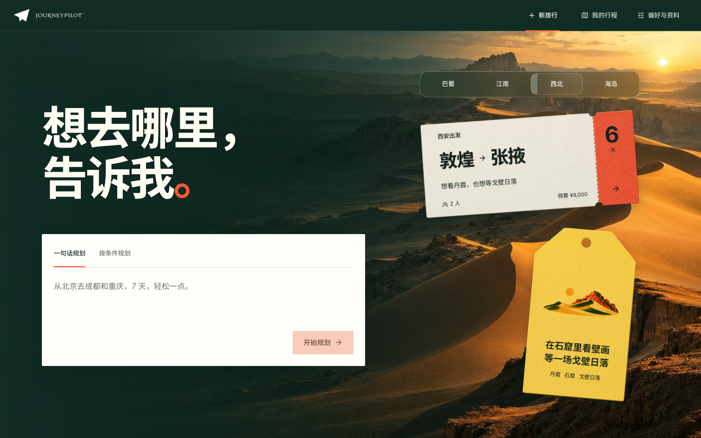
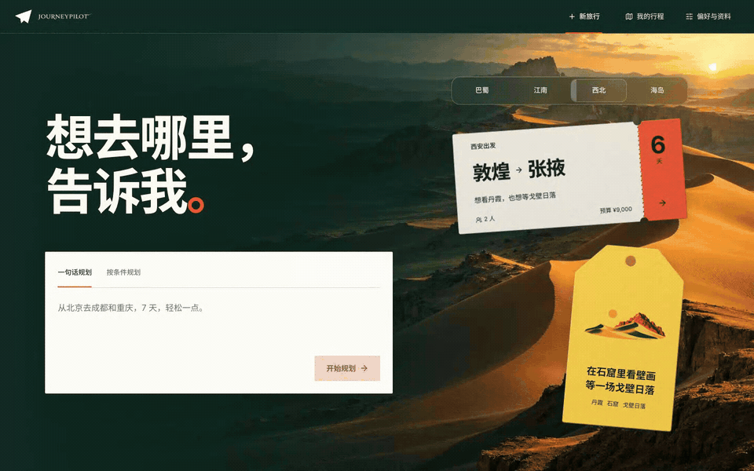
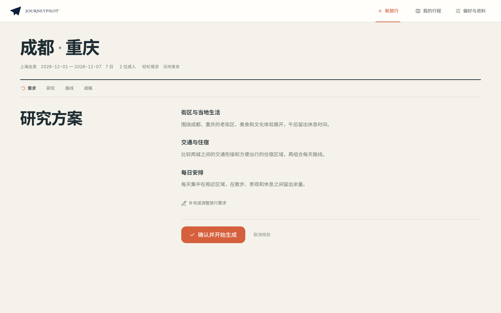
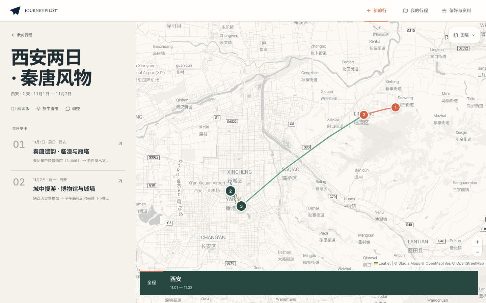
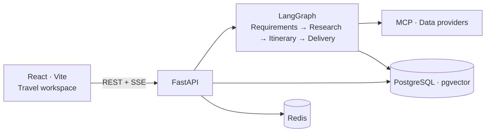

<div align="center">

<picture>
  <source media="(prefers-color-scheme: dark)" srcset="docs/assets/logo-lockup-night.png">
  <source media="(prefers-color-scheme: light)" srcset="docs/assets/logo-lockup-day.png">
  
</picture>

<h1>JourneyPilot</h1>

<p>A travel plan you can explore, discuss, and refine.</p>

[](LICENSE)
[](https://www.python.org/)
[](https://nodejs.org/)

**English** · [简体中文](README.zh-CN.md)

</div>

JourneyPilot is an open-source, self-hosted AI travel planning workspace (with a Simplified Chinese interface). Tell it where you want to go, when you are traveling, and who is coming along—it researches destinations, builds a day-by-day itinerary, and brings your schedule, interactive map, and reading view together in one place.

[Quick start](#quick-start) · [How it works](#architecture) · [Documentation](docs/README.md)





| Review the research plan | Explore the itinerary on a map |
| --- | --- |
|  |  |

[See the reading view](docs/assets/reading.png) · Map tiles: © [Stadia Maps](https://stadiamaps.com/attribution/) © [OpenMapTiles](https://openmaptiles.org/) © [OpenStreetMap contributors](https://www.openstreetmap.org/copyright)

## Plan a trip

**From idea to research plan**
Start by describing your trip in a single sentence, or switch to the structured form to fill in your route, dates, companions, budget, and travel style. You can also pick from curated inspiration proposals on the home page to jump-start a draft. Before running deep searches, JourneyPilot organizes your requirements, verifies destinations, asks brief clarifying questions when key preferences are open, and presents a research plan for you to review and confirm.

**Multi-source research and scheduling**
Once the research plan is confirmed, JourneyPilot gathers information in parallel across attractions, neighborhoods to stay, transport options (including China Railway 12306, flights, and local routing), and weather forecasts. You can follow live progress and inspect sources as tasks run. The findings are then assembled into a structured daily schedule paced around geography and opening hours.

**Map, itinerary, and reading view in sync**
The delivery workspace pairs a full-route interactive map and city stay segments with your daily schedule. Selecting any day highlights its stops, dining, lodging, and transit links right on the map. Whenever you want a clean long-form overview, slide open the reading view to browse the full guide with source citations or export it as a PDF travel handbook.

**Iterative refinement and personal memory**
Planning doesn't end with the first draft. You can continue chatting in the same workspace to adjust daily pacing, swap stops, or adapt to weather changes over multiple turns. Saved trips, reusable travel styles, personal preferences, and reference materials live in your local archive so future plans can build on what you like.

## Architecture



The backend orchestrates LLM and tool calls, persists trip state and deliverables in PostgreSQL and Redis, and streams live progress to the browser over SSE. See the [architecture overview](docs/architecture/overview.md) for module boundaries and data flow.

## Quick start

Prerequisites: [uv](https://docs.astral.sh/uv/), Python 3.11, Node.js (Node 22 recommended, see `frontend/.nvmrc`), Docker with Compose, and API credentials for an LLM provider.

**1. Clone the repository and create a config file**

```bash
git clone https://github.com/Lagom-TA/JourneyPilot.git
cd JourneyPilot
cp backend/config.example.yaml config.yaml
export UV_PROJECT_ENVIRONMENT="$PWD/.venv"
```

**2. Choose a model preset and set your API key**

The example below uses DeepSeek (`--list` shows all built-in provider presets):

```bash
uv run --project backend python backend/journeypilot.py configure --list
uv run --project backend python backend/journeypilot.py configure --provider deepseek
export JOURNEYPILOT_PRIMARY_MODEL__API_KEY="your-api-key"
export JOURNEYPILOT_FAST_MODEL__API_KEY="your-api-key"
```

**3. Start the services**

```bash
JOURNEYPILOT_DATABASE__PORT=55434 JOURNEYPILOT_REDIS__PORT=16379 ./run.sh start
```

On first run, `run.sh` installs dependencies, starts PostgreSQL and Redis via Docker Compose, applies database migrations, and launches both the backend API and frontend dev server.

| Service | URL |
| --- | --- |
| Web workspace | <http://localhost:8080> |
| API documentation | <http://localhost:8001/docs> |
| Readiness check | <http://localhost:8001/api/health/ready> |

Manage the running services from another terminal:

```bash
./run.sh status
./run.sh logs backend       # Frontend logs: ./run.sh logs frontend
./run.sh check
./run.sh stop
```

Include the port environment variables again when running `./run.sh restart`, or persist them in `config.yaml`. For common setup issues, see [local development troubleshooting](docs/local-development-troubleshooting.md).

## Run with Docker Compose

To run the web app and API together in containers, prepare `config.yaml` as shown above and create a `.env` file in the repository root with your API keys:

```dotenv
JOURNEYPILOT_PRIMARY_MODEL__API_KEY=your-api-key
JOURNEYPILOT_FAST_MODEL__API_KEY=your-api-key
```

Build and start the stack:

```bash
docker compose -f infra/compose.yml up -d --build
docker compose -f infra/compose.yml logs -f api
```

Both the web app and API will be served at <http://localhost:8001>. For self-hosted network and access-control guidance, see the [security policy](SECURITY.md).

## Configuration and data

Settings load from built-in defaults, `config.yaml`, and environment variables (in increasing order of precedence). Any scalar field can be overridden via `JOURNEYPILOT_<SECTION>__<FIELD>`, such as `JOURNEYPILOT_DATABASE__PORT`. Full details are in the [configuration reference](docs/configuration.md).

```bash
uv run --project backend python backend/journeypilot.py config validate
uv run --project backend python backend/journeypilot.py config show
uv run --project backend python backend/scripts/check_mcp.py
```

- **Tools and data providers**: Built-in tools cover web search, OpenStreetMap/Nominatim geocoding, China Railway 12306 schedules, Open-Meteo weather forecasts, and currency exchange rates. You can also configure Amap, Baidu Maps, Tavily, Brave Search, Duffel, and other MCP providers.
- **Knowledge base**: Personal reference materials are indexed locally using a built-in Qwen3 ONNX embedding model and `pgvector`, or with a compatible remote embedding endpoint.
- **Health checks and backups**: Inspect system health or create a consistent database backup via the CLI:

```bash
uv run --project backend python backend/journeypilot.py doctor
uv run --project backend python backend/journeypilot.py backup
```

## Development

```bash
# Install backend dependencies (run from repository root)
export UV_PROJECT_ENVIRONMENT="$PWD/.venv"
uv sync --project backend --locked --group local-embedding --group dev

# Pre-commit checks
uv run --project backend ruff check --config backend/pyproject.toml backend/travel_agent/ backend/tests/ backend/scripts/
uv run --project backend python backend/journeypilot.py config docs --check
uv run --project backend python backend/journeypilot.py config validate
uv run --project backend pytest -c backend/pyproject.toml backend/tests/ --ignore=backend/tests/db -q
cd frontend && npm ci && npm run check
```

See the [backend test guide](backend/tests/README.md) and [end-to-end test guide](frontend/e2e/README.md) for database integration and browser test workflows.

- [Documentation index](docs/README.md) · [Architecture](docs/architecture/overview.md) · [Configuration](docs/configuration.md)
- [Contributing](CONTRIBUTING.md) · [Security policy](SECURITY.md)

## License

Released under the [MIT License](LICENSE). Third-party data, fonts, and visual assets are listed in [NOTICE](NOTICE).
