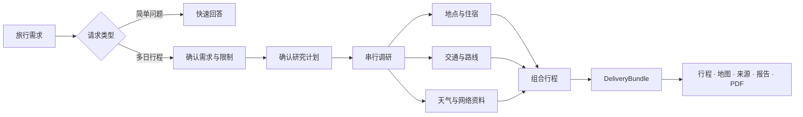

<div align="center">

<h1>JourneyPilot</h1>

<p>
  <picture>
    <source media="(prefers-color-scheme: dark)" srcset="docs/assets/logo-lockup-night.png">
    <source media="(prefers-color-scheme: light)" srcset="docs/assets/logo-lockup-day.png">
    
  </picture>
</p>

<strong>把想去的地方，变成有来源、能落地的行程。</strong>

<p>
JourneyPilot 会查询交通、地点、天气、路线和公开资料，再把结果整理成按天行程、地图、完整报告和可打印的 PDF。
</p>

[](LICENSE)
[](https://python.org)
[](https://nodejs.org/)

[English](README.md) | **简体中文**

</div>

JourneyPilot 是一个开源的、自托管的 AI 旅行规划工作台。告诉它出行日期、目的地、偏好和限制，它会把查到的信息整理成一份可以继续查看、调整和导出的行程，而不是让结果停留在一段聊天回复里。调研结果、天气、地图、报告和 PDF 始终连在一起：来源保留在它支持的事实旁边。

当前产品界面使用简体中文；代码标识符、配置键、API 契约与命令输出使用英文，文档以中文为主。

## 快速开始

### 需要准备

- [uv](https://docs.astral.sh/uv/)
- Docker Desktop，或支持 Compose 的 Docker Engine
- Python 3.11
- Node.js 22（最低 20.19）和 npm

### 启动 JourneyPilot

```bash
git clone https://github.com/Lagom-TA/JourneyPilot.git
cd JourneyPilot
cp backend/config.example.yaml config.yaml
```

按 provider preset 填好模型段，API Key 走环境变量。**Key 不要写进 `config.yaml`** —— 这份文件会被复制、被贴进 issue：

```bash
export UV_PROJECT_ENVIRONMENT="$PWD/.venv"
uv run --project backend python backend/journeypilot.py configure --list              # 可用 preset
uv run --project backend python backend/journeypilot.py configure --provider deepseek # 写好模型段
export JOURNEYPILOT_PRIMARY_MODEL__API_KEY="your-api-key"
export JOURNEYPILOT_FAST_MODEL__API_KEY="your-api-key"
```

使用仓库自带的 Docker Compose 数据库和 Redis 端口启动：

```bash
JOURNEYPILOT_DATABASE__PORT=55433 JOURNEYPILOT_REDIS__PORT=16379 ./run.sh
```

第一次启动会安装前后端依赖，通过 Compose 启动 PostgreSQL 和 Redis，执行数据库迁移，并拉起 API 与网页端。默认的本地向量模型会在首次使用时下载。

| 服务 | 地址 |
|---|---|
| 网页端 | <http://localhost:8080> |
| API 文档 | <http://localhost:8001/docs> |
| 就绪检查 | <http://localhost:8001/api/health/ready> |

常用命令：

```bash
./run.sh status
./run.sh logs backend      # 前端日志使用 frontend
./run.sh check
./run.sh stop
```

`./run.sh restart` 等价于先 `stop` 再 `start`，**不会**保存环境变量。要么每次重新带上覆盖，要么把 `database.port: 55433` 和 `redis.port: 16379` 写进 `config.yaml`。

> `backend/config.example.yaml` 默认面向本机 PostgreSQL（5433）和 Redis（6379）；仓库自带的 Compose 使用 55433 和 16379。通过上面的环境变量或直接改 `config.yaml` 把两者对齐。

### 可选增强能力

默认安装带的是核心产品：聊天、规划、PostgreSQL/pgvector、Redis、MCP 工具、PDF 导出与基础文档导入。重型增强显式安装；配置选了某个增强但依赖没装时，程序**拒绝启动**，而不是等到第一次真正调用才抛 ImportError：

```bash
uv sync --project backend                            # core：只够跑远程 embedding（embedding.provider=openai）
uv sync --project backend --group local-embedding    # 本地 Qwen3 ONNX 向量（配置默认档，run.sh 装的就是这个）
uv sync --project backend --group cross-encoder      # BGE 重排（rerank.provider=cross_encoder，会拉 torch）
```

默认的 Compose 数据库用官方 `pgvector` 镜像，不编译任何东西。中文分词增强（zhparser）是**换一个镜像**，不是 Compose profile：

```bash
docker build -t journeypilot-postgres:pg18-zhparser ./infra/postgres
POSTGRES_IMAGE=journeypilot-postgres:pg18-zhparser docker compose -f infra/compose.yml up -d
```

`journeypilot doctor` 报告 zhparser 扩展是否安装，但**不报告**已有数据库实际使用哪种 text search 配置：`knowledge_chunks.tsv` 的生成表达式在建表时就固定了。已有数据库要启用中文分词，需要重建数据库（或写一条专门的重建迁移）；只换镜像不够。

### 用 Docker Compose 自托管

Compose 会在 API 镜像内构建前端，并由 API 进程提供静态页面：

```bash
cp backend/config.example.yaml config.yaml   # 填好模型段；Compose 以只读方式挂载这份配置
docker compose -f infra/compose.yml up -d --build
```

网页端和 API 都在 <http://localhost:8001>；PostgreSQL 与 Redis 留在内部网络，宿主端口 55433/16379 留给本机工具。Provider Key 放进 `.env`（Compose 会读取，不会提交）或 shell 环境变量。Compose 镜像默认安装 `local-embedding` 依赖组，可用 `DEPENDENCY_GROUPS` 调整。

## 工作方式

JourneyPilot 会先判断请求适合快速回答还是完整规划。简单旅行问题进入快速流程；多日行程会先梳理需求，必要时追问并在回答后重新分析，再展示研究计划供确认。确认后才开展 Provider 调研、组合行程并生成最终交付。



调研阶段按执行计划逐个运行 Worker，返回的是带明确字段和来源的数据包（ResearchPacket），而不是直接写一篇行程。调度器收齐结果后构建候选目录，模型直接从目录组合行程。服务端负责结构解析，保证数据可读，并把来源记录保留在它支持的事实旁边；内容质量由模型负责。结果写入一份 `DeliveryBundle`，再生成工作台里的所有内容。

后端使用 LangGraph 和 FastAPI，数据保存在 PostgreSQL 和 Redis 中，通过 MCP 工具连接外部服务，并结合混合检索与 React 工作台完成整个规划流程。检查点和持久化的运行记录让耗时较长的任务可以恢复。

## 配置

JourneyPilot 会先读取内置默认值和 `config.yaml`，环境变量拥有最高优先级。**未知字段会被拒绝**而不是忽略：拼错的字段名应该立刻报错，而不是静默不生效。

- [`backend/config.example.yaml`](backend/config.example.yaml) —— 带注释的起点
- [`docs/configuration.md`](docs/configuration.md) —— 每个字段的类型、默认值、取值范围与环境变量名（由 `journeypilot config docs` 生成）
- [`docs/config.schema.json`](docs/config.schema.json) —— 描述 `config.yaml` 的 JSON Schema（生成物，可用于编辑器校验）

```bash
export UV_PROJECT_ENVIRONMENT="$PWD/.venv"
uv run --project backend python backend/journeypilot.py config show      # 生效值 + 每个值的来源
uv run --project backend python backend/journeypilot.py config validate  # 只校验，不启动服务
uv run --project backend python backend/journeypilot.py config env       # 全部合法环境变量名
```

每个字段都能用 `JOURNEYPILOT_<段>__<字段>` 覆盖，例如 `JOURNEYPILOT_DATABASE__PORT=55433`。认不出的 `JOURNEYPILOT_*` 变量会让启动失败 —— 拼错一个字母不该静默无效。

| 配置 | 作用 |
|---|---|
| `primary_model.*` | 规划和调研使用的主要模型，支持 OpenAI 兼容接口。 |
| `fast_model.*` | 可选的低延迟模型；连接信息留空时会沿用主要模型。 |
| `embedding.*` | 默认使用本地 Qwen3 ONNX 向量模型；`openai` 使用兼容的向量服务；`hash` 仅用于离线 smoke。 |
| `run_control.plan_gate_enabled` | 完整调研必须保持开启：调研开始前暂停并等待确认研究计划。关闭后，新的完整调研会在创建 Run 前被拒绝；快问快答不受影响。 |
| `rerank.*` | 知识库检索的第二阶段排序。 |
| `run_deadline.*` | 一次完整调研可以花掉的四段时间窗。 |
| `run_budget.*` | Run 被授权时封存的调用数 / token / 费用上限。 |
| `provider_channels.*` | 各上游通道的并发配额，避免一次入库把在线请求排到队尾。 |
| `ingest.*` | 上传与文档解析的边界（体积、页数、压缩包展开量、超时）。 |
| `mcp.servers.*` | 外部数据服务的密钥与连接设置。 |

### 数据来源

无需密钥的数据源已经可以支撑基础功能；继续配置其他服务后，可以获得更多搜索和路线数据源。

| 类型 | 自带数据源 | 可选数据源 |
|---|---|---|
| 网络资料 | DuckDuckGo、Fetch | Tavily、Brave、Firecrawl |
| 地点与路线 | OpenStreetMap、Nominatim、Transitous | 百度地图、高德地图 |
| 交通 | 中国铁路 12306 | Duffel 航班 |
| 天气与汇率 | Open-Meteo、Frankfurter | — |

在 `config.yaml` 的 `mcp.servers` 下填入服务密钥，然后运行：

```bash
uv run --project backend python backend/scripts/check_mcp.py
```

`config.yaml`、`.env*` 和其他本地密钥文件都已加入 Git 忽略列表。

仓库自带一份小规模出厂语料，位于 `backend/data/corpus/factory/`；启动后端后可在另一个终端运行 `python backend/scripts/load_factory_corpus.py` 把它装入知识库。可选的本地二进制种子没有随这个公开仓库发布，如果你维护它，请放在 `data/corpus/seed/` 下。没有本地种子时，基于 Provider 的调研仍可运行，知识库只会在就绪检查中作为非阻塞降级项报告。

## 数据库、备份与升级

API 进程不执行任何 DDL：不建表、不改列、不删数据，启动时只**只读**校验「这个库是否匹配当前代码的结构合同」。结构变更是 [`backend/migrations/versions/`](backend/migrations/versions/) 下的版本化迁移，由 `journeypilot` 执行：

```bash
export UV_PROJECT_ENVIRONMENT="$PWD/.venv"
uv run --project backend python backend/journeypilot.py doctor          # 体检：数据库、迁移版本、结构、扩展、备份现状
uv run --project backend python backend/journeypilot.py migrate         # 执行待迁移（持锁；非空库先自动备份）
uv run --project backend python backend/journeypilot.py backup          # 生成经过校验的备份：转储 + manifest + SHA-256
uv run --project backend python backend/journeypilot.py restore <目录> --yes  # 恢复到新库、验证通过后再切换
```

每个命令都支持 `--json`，供 CI 使用。

`migrate` 跑在 API **之前**，不是与它并行。两条官方入口都已经替你做了这件事：Docker 镜像的 entrypoint 和 `./run.sh start` 各自先跑一次迁移，不通过就不启动 API。让 API 连上一个没迁移过的库不是「降级运行」——`GET /api/health/ready` 返回 503，并给出具体问题和能修好它的命令。

因为 API 不需要 DDL 权限，你可以用一个只有 `SELECT/INSERT/UPDATE/DELETE` 和 sequence 使用权的 PostgreSQL 角色运行它，把结构所有权留给 `journeypilot migrate`。这一点有测试保证。

这几道保护具体做了什么：

- **非空数据库在任何迁移之前必定先备份**，而且备份要通过校验（文件非空、`pg_restore --list` 能解析、checksum 已记录）。备份失败就不迁移。
- **没有已知 revision 的非空数据库会被拒绝。** 有 JourneyPilot 表但没有 `alembic_version` 的库不会被纳管或 stamp：请重建数据库，或从匹配的备份恢复。结构漂移时 `doctor` 会逐条列出差异的列、约束和索引。
- **会删数据的迁移需要 `--allow-destructive`。** 空库首次安装不需要 —— 那里没有数据可丢。
- **恢复绝不原地覆盖当前数据库。** 它先恢复到一个新库，比对结构指纹和行数，通过之后才切换；恢复前的数据库保留为 `<库名>_prerestore_<时间戳>`，直到你自己删除。
- **LangGraph 的 checkpoint 表同样由 `migrate` 建**，不由 API 建。它们的 owner 是 `langgraph-checkpoint-postgres` 并自带版本表；缺了它们，API 会报告 `checkpointer` 不可用，而不是等第一次 interrupt 才失败。

`config.yaml` 里的 `maintenance.*` 控制备份目录、保留份数和锁超时。备份目录不进版本控制。

## 参与开发

让前端连接本地 API：

```bash
cd frontend
npm ci
npm run dev
```

提交 Pull Request 前，请完成本地检查，并验证本次改动影响的实际功能：

```bash
export UV_PROJECT_ENVIRONMENT="$PWD/.venv"

# 后端
uv sync --project backend --locked --group local-embedding --group dev
uv run --project backend ruff check --config backend/pyproject.toml backend/travel_agent/ backend/tests/ backend/scripts/
uv run --project backend python backend/journeypilot.py config validate
uv run --project backend python backend/journeypilot.py config docs --check    # 生成的字段表与 schema 一致
JOURNEYPILOT_DATABASE__PORT=55433 uv run --project backend pytest -c backend/pyproject.toml      # db 测试建临时库；没有 PostgreSQL 时自动跳过

# 前端
cd frontend
npm run check                                        # 类型检查 + lint + 单元测试 + 构建
npm run test:e2e                                     # 需要一套跑着的服务，见 frontend/e2e/README.md
```

[CI](.github/workflows/pr.yml) 自动运行后端 lint、配置与单元测试、离线迁移 SQL，前端类型检查/lint/单元测试/构建，MCP 依赖安装，shell 检查，Docker 构建 smoke，以及密钥扫描。数据库迁移与集成测试可在 Actions 的 `PR` 工作流中点击 **Run workflow** 手动执行。完整应用的浏览器与真实 Provider 验证按需在本地运行，数据库测试跳过不等于验证通过。不保留定时 nightly 或 release 工作流。

### 文档

- [`docs/README.md`](docs/README.md) —— 文档索引
- [`docs/adr/`](docs/adr/) —— 做过的决定，以及被否掉的替代方案
- [`docs/invariants.md`](docs/invariants.md) —— 代码必须保留的运行时保证
- [`docs/architecture/overview.md`](docs/architecture/overview.md) —— 一次请求怎么走完全程
- [`docs/local-development-troubleshooting.md`](docs/local-development-troubleshooting.md) —— 本地启动排障

欢迎提交 Issue 和 Pull Request，见 [CONTRIBUTING.md](CONTRIBUTING.md)；安全问题请按 [SECURITY.md](SECURITY.md) 报告。请尽量让每次改动保持聚焦；修复缺陷时补上回归测试；如果改动影响用户可见的行为，也请同步更新中英文 README。

## 技术栈

| 层 | 技术 |
|---|---|
| 前端 | React 18、TypeScript、Vite、Tailwind CSS、Leaflet、Motion |
| API | FastAPI、Uvicorn、Server-Sent Events |
| Agent 工作流 | LangGraph 与 PostgreSQL 检查点 |
| 模型 | 通过 `langchain-openai` 接入 OpenAI 兼容模型 |
| 数据 | PostgreSQL、pgvector、Redis（zhparser 可选） |
| 检索 | 向量检索、PostgreSQL 全文检索、RRF、重排 |
| 工具 | 基于 stdio 的 Model Context Protocol |
| 包管理与运行 | uv、npm、Docker Compose |

## 许可

JourneyPilot 使用 [MIT License](LICENSE) 开源。第三方数据、字体与素材见 [NOTICE](NOTICE)。

## 致谢

JourneyPilot 使用了 [LangGraph](https://github.com/langchain-ai/langgraph)、[Model Context Protocol](https://modelcontextprotocol.io/)、[pgvector](https://github.com/pgvector/pgvector)，以及来自 [Open-Meteo](https://open-meteo.com/)、[Frankfurter](https://frankfurter.dev/)、[OpenStreetMap](https://www.openstreetmap.org/)、Nominatim 和 [Transitous](https://transitous.org/) 的开放数据。
