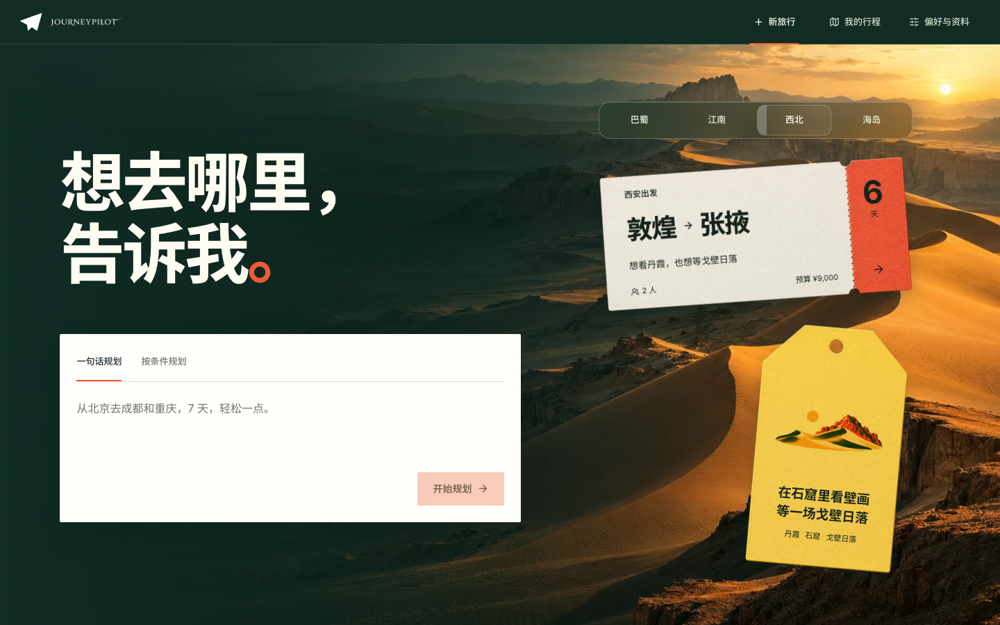
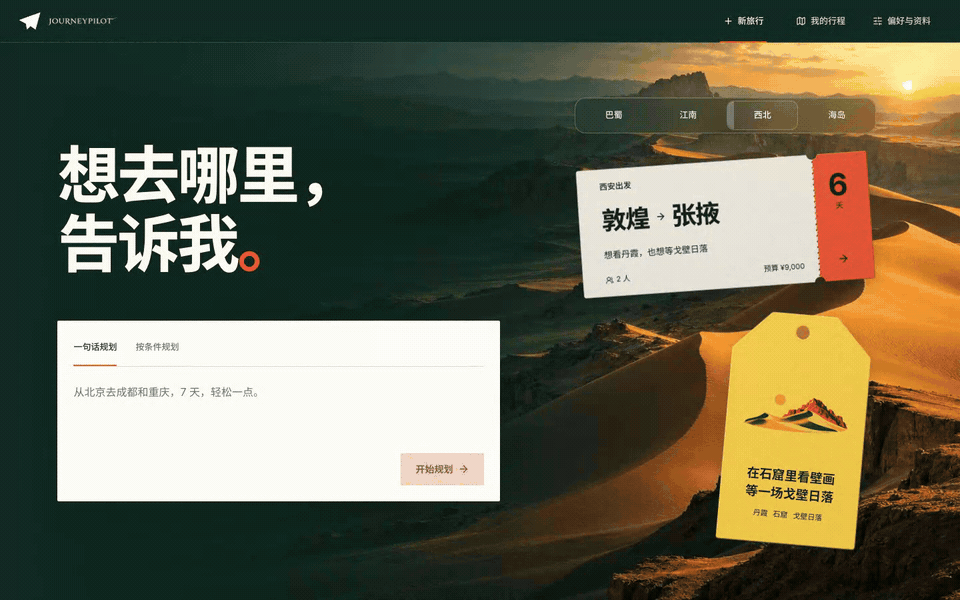
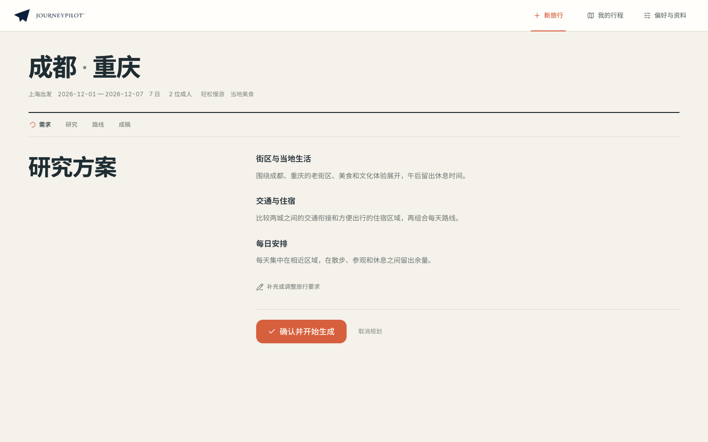
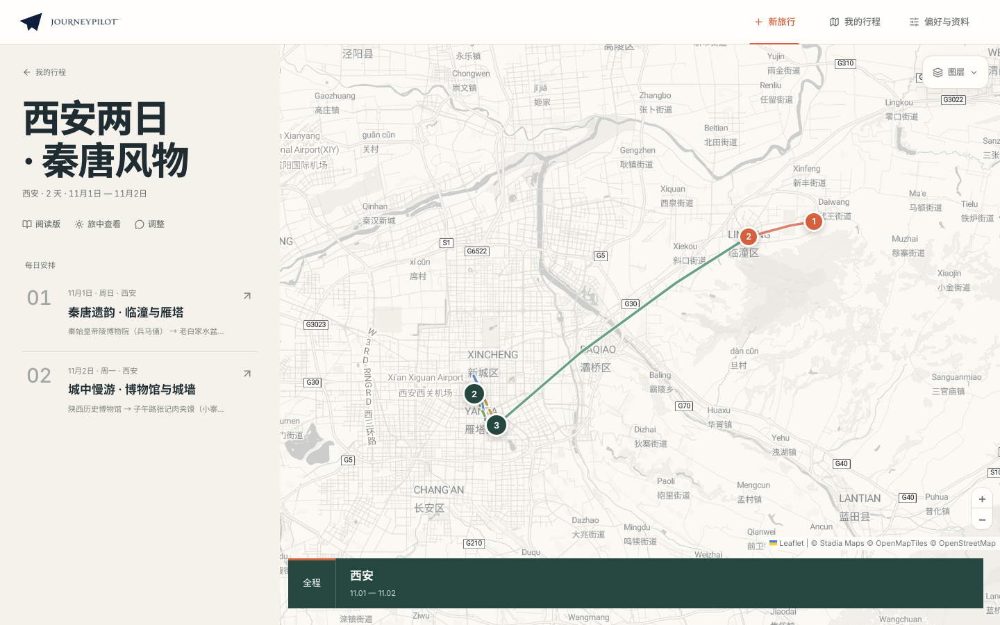
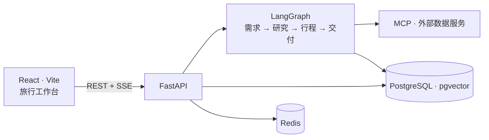

<div align="center">

<picture>
  <source media="(prefers-color-scheme: dark)" srcset="docs/assets/logo-lockup-night.png">
  <source media="(prefers-color-scheme: light)" srcset="docs/assets/logo-lockup-day.png">
  
</picture>

<h1>JourneyPilot</h1>

<p>一份能继续查看、讨论和调整的旅行计划。</p>

[](LICENSE)
[](https://www.python.org/)
[](https://nodejs.org/)

[English](README.md) · **简体中文**

</div>

JourneyPilot 是一个开源、自托管的 AI 旅行规划工作台。告诉它你想去哪里、什么时候出发、和谁同行，它会搜集目的地资料，编排每日行程，并把日程、交互地图和深度阅读版呈现在同一个工作区里。

[快速开始](#快速开始) · [系统架构](#系统架构) · [文档索引](docs/README.md)





| 确认研究方案 | 在地图上探索行程 |
| --- | --- |
|  |  |

[查看阅读版](docs/assets/reading.png) · 地图底图：© [Stadia Maps](https://stadiamaps.com/attribution/) © [OpenMapTiles](https://openmaptiles.org/) © [OpenStreetMap contributors](https://www.openstreetmap.org/copyright)

## 规划一趟旅行

**从想法到研究方案**
你可以直接用一句话描述旅行想法，也可以切换到结构化表单填写路线、日期、同行人数、预算和旅行风格；首页还准备了多组旅行灵感提案，点击即可带入修改。开始规划后，系统会先梳理需求、核实目的地信息，并在关键偏好尚不明确时向你追问。在展开大规模搜索前，JourneyPilot 会先给出一份研究方案，由你确认或补充方向后再正式启动调研。

**多维度调研与日程编排**
围绕确认的研究方案，系统会并行搜集景点、住宿、交通（含 12306 铁路、航班与市内路线）以及当地天气，并在工作台实时展示各阶段的调研进展与参考来源。调研完成后，零散的资料会被整理为按天展开的行程，兼顾地理动线、开放时段与游览节奏。

**地图、日程与阅读版联动**
交付工作台将全程路线图、城市停留分段和每日日程结合在同一视野中。点击任意一天的行程，可以在地图上查看对应的景点、餐厅、住宿和交通接驳；切换至阅读版即可通读附带资料来源的完整路书，或直接导出为 PDF 旅行手册。

**持续微调与个人偏好积累**
生成的行程可以随时通过对话继续打磨——无论是调整某一天的节奏、替换景点，还是根据天气变化准备备选方案，都能在同一趟旅行上下文中完成。你的历史行程、常用旅行风格、个人偏好以及参考资料都会保存在本地档案中，供后续规划直接调用。

## 系统架构



后端负责协调大模型与外部工具调用，通过 PostgreSQL 与 Redis 持久化会话状态和行程结果，并以 SSE 流式向浏览器推送实时进展。模块划分与完整数据流见[架构总览](docs/architecture/overview.md)。

## 快速开始

运行环境需要 [uv](https://docs.astral.sh/uv/)、Python 3.11、Node.js（推荐 22，见 `frontend/.nvmrc`）、Docker（含 Compose），以及可用的大模型 API 密钥。

**1. 克隆仓库并初始化配置文件**

```bash
git clone https://github.com/Lagom-TA/JourneyPilot.git
cd JourneyPilot
cp backend/config.example.yaml config.yaml
export UV_PROJECT_ENVIRONMENT="$PWD/.venv"
```

**2. 选择模型预设并配置 API Key**

下面以 DeepSeek 为例（可通过 `--list` 查看全部支持的供应商预设）：

```bash
uv run --project backend python backend/journeypilot.py configure --list
uv run --project backend python backend/journeypilot.py configure --provider deepseek
export JOURNEYPILOT_PRIMARY_MODEL__API_KEY="your-api-key"
export JOURNEYPILOT_FAST_MODEL__API_KEY="your-api-key"
```

**3. 启动服务**

```bash
JOURNEYPILOT_DATABASE__PORT=55434 JOURNEYPILOT_REDIS__PORT=16379 ./run.sh start
```

首次启动会自动安装前后端依赖，通过 Docker Compose 启动 PostgreSQL 与 Redis，执行数据库迁移，随后启动后端 API 与前端开发服务。

| 服务 | 地址 |
| --- | --- |
| 网页工作台 | <http://localhost:8080> |
| API 文档 | <http://localhost:8001/docs> |
| 就绪检查 | <http://localhost:8001/api/health/ready> |

日常管理命令（在另一个终端中执行）：

```bash
./run.sh status
./run.sh logs backend       # 查看前端日志：./run.sh logs frontend
./run.sh check
./run.sh stop
```

若使用 `./run.sh restart` 重启服务，请同样带上端口环境变量，或将端口直接写入 `config.yaml`。遇到环境或端口问题可查阅[本地启动排障](docs/local-development-troubleshooting.md)。

## 使用 Docker Compose

除本地开发脚本外，也可以将前端与后端一并运行在容器中。先按上文准备好 `config.yaml`，然后在仓库根目录创建 `.env` 文件填入所需的服务密钥：

```dotenv
JOURNEYPILOT_PRIMARY_MODEL__API_KEY=your-api-key
JOURNEYPILOT_FAST_MODEL__API_KEY=your-api-key
```

构建并启动容器：

```bash
docker compose -f infra/compose.yml up -d --build
docker compose -f infra/compose.yml logs -f api
```

启动后，网页与 API 均通过 <http://localhost:8001> 访问。关于自托管部署的网络与访问控制建议，请参阅[安全策略](SECURITY.md)。

## 配置与数据

系统配置按“内置默认值 → `config.yaml` → 环境变量”的顺序合并，环境变量优先级最高。常用配置项均可通过 `JOURNEYPILOT_<段>__<字段>` 覆盖（如 `JOURNEYPILOT_DATABASE__PORT`）。完整字段说明见[配置参考](docs/configuration.md)。

```bash
uv run --project backend python backend/journeypilot.py config validate
uv run --project backend python backend/journeypilot.py config show
uv run --project backend python backend/scripts/check_mcp.py
```

- **数据与工具服务**：开箱内置网页搜索、OpenStreetMap/Nominatim 地理编码、12306 铁路查询、Open-Meteo 天气及汇率转换；支持按需接入高德地图、百度地图、Tavily、Brave Search、Duffel 等服务。
- **个人知识库**：内置基于 Qwen3 ONNX 的本地向量嵌入模型与 `pgvector` 检索，也支持配置远程 Embedding 服务。
- **健康检查与备份**：支持通过命令行检查数据库状态或创建数据快照备份：

```bash
uv run --project backend python backend/journeypilot.py doctor
uv run --project backend python backend/journeypilot.py backup
```

## 开发

```bash
# 安装后端依赖（在仓库根目录执行）
export UV_PROJECT_ENVIRONMENT="$PWD/.venv"
uv sync --project backend --locked --group local-embedding --group dev

# 提交前检查
uv run --project backend ruff check --config backend/pyproject.toml backend/travel_agent/ backend/tests/ backend/scripts/
uv run --project backend python backend/journeypilot.py config docs --check
uv run --project backend python backend/journeypilot.py config validate
uv run --project backend pytest -c backend/pyproject.toml backend/tests/ --ignore=backend/tests/db -q
cd frontend && npm ci && npm run check
```

数据库集成测试与浏览器端到端测试的运行方式分别见[后端测试说明](backend/tests/README.md)与[端到端测试说明](frontend/e2e/README.md)。

- [文档索引](docs/README.md) · [架构总览](docs/architecture/overview.md) · [配置参考](docs/configuration.md)
- [参与贡献](CONTRIBUTING.md) · [安全策略](SECURITY.md)

## 许可

本项目采用 [MIT License](LICENSE) 开源。第三方数据、字体与素材声明见 [NOTICE](NOTICE)。
